<!-- Animated waving header -->

<!-- Animated banner -->

  

<!-- Typing animation -->

  

  
  

  
  
  
  

## 🚀 About Me

> 🔭 **Working on:** Building cool things with Python, Java & AWS ☁️ — exploring Terraform, IaC & Cloud Automation
>
> 🌱 **Learning:** AI/ML concepts, problem-solving & DSA
>
> 👯 **Collaborate on:** AI, Python, Java, cloud & problem-solving projects
>
> 🤝 **Need help with:** Turning tricky problems into clean solutions, sharpening DSA, building smarter AI-powered projects
>
> 💬 **Ask me about:** Python, Java, DSA, backend development, AI/ML fundamentals & practical software solutions
>
> 📫 **Reach me:** [sruthy.saravanan05@gmail.com](mailto:sruthy.saravanan05@gmail.com)

## 🛠️ Tech Stack

<b>💻 Languages & Frameworks</b>

  

<b>☁️ Cloud & DevOps</b>

  

<b>🗄️ Databases & Messaging</b>

  

<b>🤖 AI / ML & Data</b>

  

<b>🧰 Tools</b>

  

## 📊 GitHub Stats

  
  

  

  

<!-- Footer -->

