  

  

  
  
  
  

## 🚀 About Me

- 🔭 **Working on:** Python, Java & AWS projects, exploring Terraform, IaC & cloud automation
- 🌱 **Learning:** AI/ML concepts, problem-solving & DSA
- 👯 **Collaborate on:** AI, Python, Java, cloud & problem-solving projects
- 🤝 **Need help with:** Turning tricky problems into clean solutions & building AI-powered projects
- 💬 **Ask me about:** Python, Java, DSA, backend development, AI/ML fundamentals
- 📫 **Reach me:** sruthy.saravanan05@gmail.com

## 🛠️ Tech Stack

   
   
   
  

## 📊 GitHub Stats

  
  

